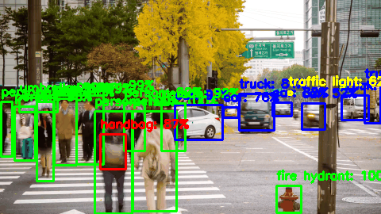
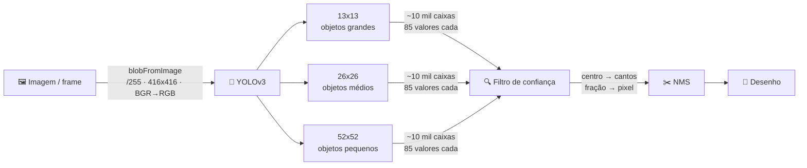

# 🎯 yolo-opencv-detection

Detecção de objetos em **imagem, vídeo e webcam** com YOLOv3 pré-treinado no COCO (80 classes), rodando direto no módulo `dnn` do OpenCV: sem PyTorch, sem GPU, só CPU.

> Projeto de estudo: o mesmo pipeline implementado duas vezes, num notebook didático (imagem) e num script de tempo real (vídeo/webcam).

<p align="center"></p>

## Visão geral

| Arquivo | Função | Entrada | Como rodar |
|---|---|---|---|
| `yolo_detect_image.ipynb` | Pipeline passo a passo, uma etapa por célula | imagem | Jupyter / VS Code |
| `yolo_detect_video.py` | Detecção em tempo real com FPS na tela | vídeo ou webcam | `python yolo_detect_video.py` |
| `download_models.py` | Baixa os pesos do YOLOv3 | — | `python download_models.py` |

| Modelo | mAP (COCO) | FLOPS | Quando usar |
|---|---|---|---|
| `yolov3-tiny` | 33.1 | 5.56 Bn | tempo real em CPU |
| `yolov3` (416) | 55.3 | 65.86 Bn | quando a precisão importa mais que a velocidade |

## Estrutura do repositório

```
yolo-opencv-detection/
├── yolo_detect_image.ipynb   # imagem, passo a passo
├── yolo_detect_video.py      # vídeo / webcam
├── download_models.py        # baixa os .weights
├── make_demo_gif.py          # gera o assets/demo.gif (precisa do Pillow)
├── requirements.txt
├── assets/
│   └── demo.gif
├── models/
│   ├── coco.names            # as 80 classes, na ordem do treino
│   ├── yolov3.cfg            # arquitetura do modelo completo
│   ├── yolov3-tiny.cfg       # arquitetura do modelo leve
│   └── *.weights             # pesos (gitignored, ~270 MB no total)
└── samples/
    ├── yoloTeste.jpg
    └── videoTeste.mp4
```

Só o código, as arquiteturas (`.cfg`) e as amostras ficam no git. Os pesos são baixados pelo `download_models.py`, porque o `yolov3.weights` tem 248 MB, acima do limite de 100 MB por arquivo do GitHub.

## Arquitetura



Para o código, cada frame de vídeo é só mais uma imagem: o mesmo pipeline roda em loop. O YOLOv3-tiny não tem a grade de 52x52, e por isso erra mais em objetos pequenos.

## Por que dois limiares?

```python
cv2.dnn.NMSBoxes(boxes, confidences, CONF_THRESHOLD, NMS_THRESHOLD)
```

| Limiar | Padrão | Mede | Alto demais | Baixo demais |
|---|---|---|---|---|
| `CONF_THRESHOLD` | 0.5 | uma caixa sozinha: "tem objeto?" | perde objetos reais | aparece lixo |
| `NMS_THRESHOLD` | 0.4 | duas caixas juntas (IoU): "é duplicata?" | sobram duplicatas | apaga objetos encostados |

- ✅ O **mesmo** `CONF_THRESHOLD` vale no filtro e no NMS, então os dois nunca discordam.
- ✅ O IoU fica **separado** da confiança: dá para baixar a confiança para pegar objetos difíceis sem apagar uma pessoa encostada num carro.
- ⚠️ Com limiares diferentes no filtro e no NMS, as detecções somem sem erro nenhum. Foi o que aconteceu aqui com o **YOLOv3-tiny**: ele detectava pessoas de costas com só 30–40% de confiança, e elas passavam pelo filtro (0.2) mas eram descartadas pelo NMS (0.5).
- ⚠️ O `NMSBoxes` ignora a classe. Com muita sobreposição, pode apagar um objeto de outra classe que está encostado.

## Quick start

```bash
# 1. Clonar
git clone https://github.com/antonioheitorga/yolo-opencv-detection.git && cd yolo-opencv-detection

# 2. Instalar as dependências (OpenCV, NumPy, matplotlib)
pip install -r requirements.txt

# 3. Baixar os pesos (os dois modelos, ou só um: python download_models.py yolov3-tiny)
python download_models.py

# 4. Rodar no vídeo de exemplo
python yolo_detect_video.py
```

Para a imagem, abra o `yolo_detect_image.ipynb` e execute as células em ordem.

## Uso

```bash
python yolo_detect_video.py
```

Para trocar o vídeo, o modelo ou os limiares, edite as constantes no topo do `yolo_detect_video.py`:

| Constante | Padrão | O que controla |
|---|---|---|
| `VIDEO_PATH` | `samples/videoTeste.mp4` | caminho do vídeo; use `0` para a webcam |
| `MODEL_NAME` | `"yolov3"` | `"yolov3"` ou `"yolov3-tiny"` (mais rápido) |
| `CONF_THRESHOLD` | 0.5 | confiança mínima |
| `NMS_THRESHOLD` | 0.4 | IoU máximo entre caixas |

`q` encerra. O FPS e o modelo ativo aparecem no canto do vídeo.

### 🎞️ Gerar um GIF do seu teste

Testou com o seu próprio vídeo e quer guardar o resultado? O `make_demo_gif.py` gera um GIF com a detecção, do mesmo jeito que o GIF do topo deste README foi feito:

```bash
pip install pillow                                              # só na primeira vez
python make_demo_gif.py --source meu_video.mp4 --output meu_teste.gif
python make_demo_gif.py --source meu_video.mp4 --width 480 --step 3
```

O GIF usa o mesmo modelo e os mesmos limiares definidos no `yolo_detect_video.py`.

| Parâmetro | Padrão | O que controla |
|---|---|---|
| `--source` | `samples/videoTeste.mp4` | vídeo de entrada (arquivo, não webcam) |
| `--output` | `assets/demo.gif` | onde salvar o GIF |
| `--width` | 640 | largura do GIF em pixels |
| `--step` | 2 | usa 1 a cada N frames; aumente para um GIF menor |

> 💡 Sem `--output`, o GIF substitui o `assets/demo.gif` do README. GIFs ficam pesados rápido: para vídeos longos, use `--width 480` ou `--step 3`.

## Habilidades desenvolvidas

Algumas das habilidades desenvolvidas durante os treinos:

🧩 **Montar o pipeline completo de detecção, do pixel à caixa desenhada:**

| Etapa | O que acontece |
|---|---|
| 🖼️ Pré-processamento | a imagem vira um blob: pixels normalizados, 416x416, BGR → RGB |
| 🧠 Inferência | a rede devolve milhares de caixas candidatas |
| 🔍 Filtragem | só ficam as caixas com confiança acima do limiar |
| ✂️ NMS | as caixas duplicadas do mesmo objeto são removidas |
| 🎨 Desenho | caixa, classe e confiança aparecem na imagem |

## Erros encontrados no caminho

| Sintoma | Causa | Solução |
|---|---|---|
| **(YOLOv3-tiny)** Pessoas de costas sumiam depois do NMS | o tiny, por ser a versão leve, detectava essas pessoas com só 30–40% de confiança; elas passavam pelo filtro (0.2), mas o NMS recebia 0.5 e as descartava | usar o mesmo `CONF_THRESHOLD` nos dois e, quando a precisão importa, trocar para o `yolov3` completo |
| O mesmo objeto com várias caixas | células vizinhas e grades diferentes detectam o mesmo objeto | NMS |

## Créditos

Baseado nos exemplos do curso [Computer Vision: YOLO Custom Object Detection with Colab GPU](https://www.coursera.org/learn/packt-computer-vision-yolo-custom-object-detection-with-colab-gpu-ixaf4) (Packt / Coursera), com modificações próprias. Pesos e arquitetura do YOLOv3 por [Joseph Redmon](https://pjreddie.com/darknet/yolo/). Desenvolvido com auxílio do Claude (Anthropic) para tirar dúvidas, montar esse documento e revisar a implementação.
