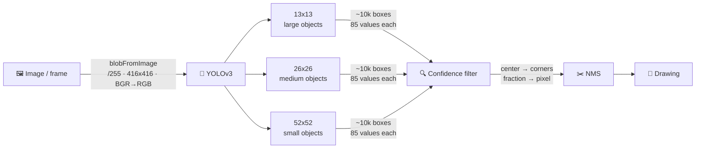

🇺🇸 English | [🇧🇷 Português](README.pt-BR.md)

# 🎯 yolo-opencv-detection

Object detection on **images, video and webcam** with YOLOv3 pre-trained on COCO (80 classes), running directly on OpenCV's `dnn` module: no PyTorch, no CUDA. Runs on CPU, or on the GPU via OpenCL when available.

> Study project: the same pipeline implemented twice, as a step-by-step notebook (image) and as a real-time script (video/webcam). Code comments are in Portuguese.

<p align="center"></p>

## Overview

| File | Purpose | Input | How to run |
|---|---|---|---|
| `yolo_detect_image.ipynb` | Step-by-step pipeline, one stage per cell | image | Jupyter / VS Code |
| `yolo_detect_video.py` | Real-time detection with on-screen FPS | video or webcam | `python yolo_detect_video.py` |
| `download_models.py` | Downloads the YOLOv3 weights | — | `python download_models.py` |

| Model | mAP (COCO) | FLOPS | When to use |
|---|---|---|---|
| `yolov3-tiny` | 33.1 | 5.56 Bn | real time on CPU |
| `yolov3` (416) | 55.3 | 65.86 Bn | when accuracy matters more than speed |

## Repository layout

```
yolo-opencv-detection/
├── yolo_detect_image.ipynb   # image, step by step
├── yolo_detect_video.py      # video / webcam
├── download_models.py        # downloads the .weights
├── make_demo_gif.py          # generates assets/demo.gif (needs Pillow)
├── requirements.txt
├── LICENSE                   # MIT
├── assets/
│   └── demo.gif
├── models/
│   ├── coco.names            # the 80 classes, in training order
│   ├── yolov3.cfg            # full model architecture
│   ├── yolov3-tiny.cfg       # lightweight model architecture
│   └── *.weights             # weights (gitignored, ~270 MB total)
└── samples/
    ├── yoloTeste.jpg
    └── videoTeste.mp4
```

Only the code, the architectures (`.cfg`) and the samples are tracked in git. The weights are fetched by `download_models.py`, because `yolov3.weights` is 248 MB, above GitHub's 100 MB per-file limit.

## Architecture



To the code, each video frame is just another image: the same pipeline runs in a loop. YOLOv3-tiny has no 52x52 grid, which is why it struggles more with small objects.

## Why two thresholds?

```python
cv2.dnn.NMSBoxes(boxes, confidences, CONF_THRESHOLD, NMS_THRESHOLD)
```

| Threshold | Default | Measures | Too high | Too low |
|---|---|---|---|---|
| `CONF_THRESHOLD` | 0.5 | a single box: "is there an object?" | misses real objects | noise shows up |
| `NMS_THRESHOLD` | 0.4 | two boxes together (IoU): "is it a duplicate?" | duplicates remain | removes objects touching each other |

- ✅ The **same** `CONF_THRESHOLD` is used in the filter and in NMS, so the two never disagree.
- ✅ IoU is kept **separate** from confidence: you can lower confidence to catch hard objects without deleting a person standing next to a car.
- ⚠️ With different thresholds in the filter and in NMS, detections vanish without any error. That is what happened here with **YOLOv3-tiny**: it detected people seen from behind at only 30–40% confidence, so they passed the filter (0.2) but were discarded by NMS (0.5).
- ⚠️ `NMSBoxes` ignores the class. With heavy overlap, it can remove a touching object of a different class.

## Quick start

```bash
# 1. Clone
git clone https://github.com/antonioheitorga/yolo-opencv-detection.git && cd yolo-opencv-detection

# 2. Install dependencies (OpenCV, NumPy, matplotlib)
pip install -r requirements.txt

# 3. Download the weights (both models, or just one: python download_models.py yolov3-tiny)
python download_models.py

# 4. Run on the sample video
python yolo_detect_video.py
```

For the image, open `yolo_detect_image.ipynb` and run the cells in order.

## Usage

```bash
python yolo_detect_video.py
```

To change the video, the model or the thresholds, edit the constants at the top of `yolo_detect_video.py`:

| Constant | Default | Controls |
|---|---|---|
| `VIDEO_PATH` | `samples/videoTeste.mp4` | video path; use `0` for the webcam |
| `MODEL_NAME` | `"yolov3"` | `"yolov3"` or `"yolov3-tiny"` (faster) |
| `CONF_THRESHOLD` | 0.5 | minimum confidence |
| `NMS_THRESHOLD` | 0.4 | maximum IoU between boxes |

Press `q` to quit. The FPS and the active model are shown in the corner of the video.

### 🎞️ Make a GIF of your own test

Tried it on your own video and want to keep the result? `make_demo_gif.py` creates a GIF of the detection, the same way the GIF at the top of this README was made:

```bash
pip install pillow                                              # first time only
python make_demo_gif.py --source my_video.mp4 --output my_test.gif
python make_demo_gif.py --source my_video.mp4 --width 480 --step 3
```

The GIF uses the same model and thresholds defined in `yolo_detect_video.py`.

| Option | Default | Controls |
|---|---|---|
| `--source` | `samples/videoTeste.mp4` | input video (file, not webcam) |
| `--output` | `assets/demo.gif` | where to save the GIF |
| `--width` | 640 | GIF width in pixels |
| `--step` | 2 | keeps 1 of every N frames; increase for a smaller GIF |

> 💡 Without `--output`, the GIF replaces this README's `assets/demo.gif`. GIFs get heavy fast: for long videos, use `--width 480` or `--step 3`.

## Skills developed

Some of the skills developed during training:

🧩 **Building the complete detection pipeline, from pixels to drawn boxes:**

| Stage | What happens |
|---|---|
| 🖼️ Preprocessing | the image becomes a blob: normalized pixels, 416x416, BGR → RGB |
| 🧠 Inference | the network returns thousands of candidate boxes |
| 🔍 Filtering | only boxes with confidence above the threshold are kept |
| ✂️ NMS | duplicate boxes for the same object are removed |
| 🎨 Drawing | box, class and confidence are drawn on the image |

## Issues found along the way

| Symptom | Cause | Fix |
|---|---|---|
| **(YOLOv3-tiny)** People seen from behind disappeared after NMS | tiny, being the lightweight version, detected them at only 30–40% confidence; they passed the filter (0.2), but NMS received 0.5 and discarded them | use the same `CONF_THRESHOLD` in both and, when accuracy matters, switch to the full `yolov3` |
| The same object with several boxes | neighboring cells and different grids detect the same object | NMS |

## Credits

Based on the examples from the course [Computer Vision: YOLO Custom Object Detection with Colab GPU](https://www.coursera.org/learn/packt-computer-vision-yolo-custom-object-detection-with-colab-gpu-ixaf4) (Packt / Coursera), with my own modifications. YOLOv3 weights and architecture by [Joseph Redmon](https://pjreddie.com/darknet/yolo/). Sample video from [Pixabay](https://pixabay.com/pt/videos/seul-rua-tráfego-carros-rapidez-21115/); the sample image is a frame from the same video. Developed with help from Claude (Anthropic) for answering questions, writing this document and reviewing the implementation.

## License

[MIT](LICENSE) © Antonio Heitor
